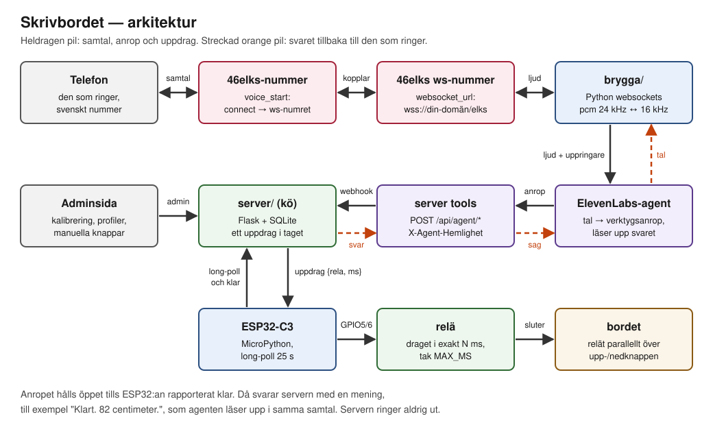
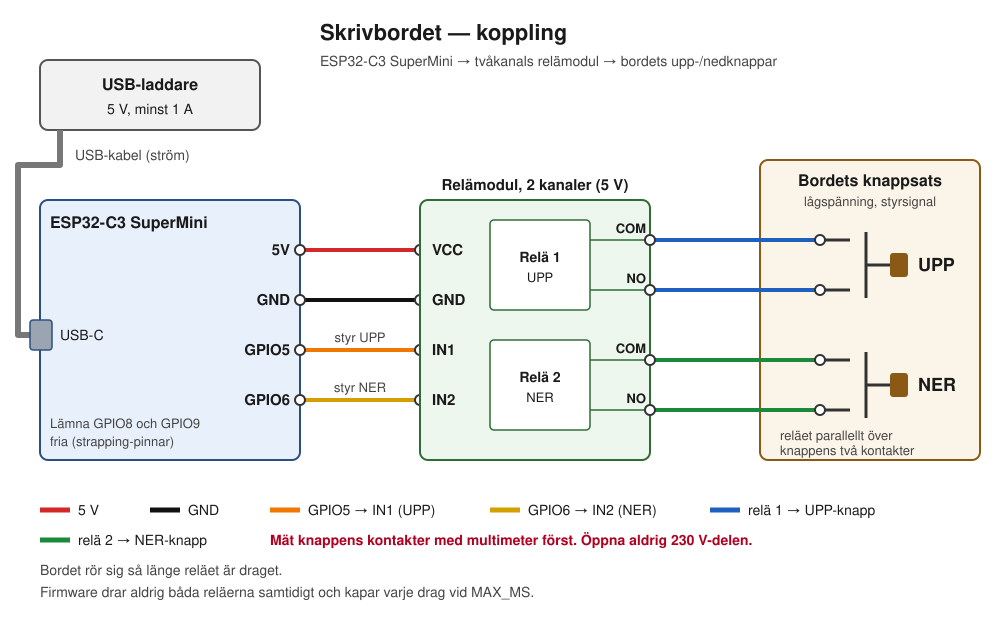

# Skrivbordet — styr ett höj- och sänkbart bord med rösten, över telefon

Ring ett nummer och säg vad bordet ska göra. Bordet rör sig medan du håller luren, och
när det har stannat säger rösten var det står:

> **Skrivbordet:** Ja?
> **Du:** Sänk tio.
> **Skrivbordet:** Jo.
> *(bordet går ner i ett par sekunder)*
> **Skrivbordet:** Klart. 82 centimeter.

Det förstår också "stå", "sitt", "ställ det på 100" och sparade profiler ("spara min höjd
som Anna", "Annas höjd", "vilka profiler finns"). Agenten är fåordig med flit.

Det behövs ingen höjdsensor och inget ingrepp i bordets elektronik: ett relä sitter
parallellt över bordets upp- och nedknapp och "håller in knappen" i exakt så många
millisekunder som sträckan kräver. Positionen räknas fram ur en kalibrerad restid och
nollställs varje gång bordet körs till ett ändläge.

## Innehåll

- [Hur det hänger ihop](#hur-det-hänger-ihop)
- [Hårdvara](#hårdvara)
- [Koppling](#koppling)
- [Mjukvara steg för steg](#mjukvara-steg-för-steg)
- [46elks websocket-protokollet](#46elks-websocket-protokollet)
- [Felsökning](#felsökning)
- [Säkerhet och kostnader](#säkerhet-och-kostnader)
- [Verifiering](#verifiering)
- [Licens](#licens)

## Hur det hänger ihop



1. Du ringer ett vanligt **46elks-nummer**. Det kopplar samtalet vidare (`voice_start`
   med `connect`) till ett **46elks websocket-nummer**.
2. Websocket-numret öppnar en websocket mot **bryggan** (`brygga/`), som kontrollerar att
   du ringer från ett svenskt nummer och sedan kopplar ljudet till en **ElevenLabs
   Conversational AI-agent**.
3. Agenten tolkar vad du säger och anropar ett **server tool** — en webhook mot
   **servern** (`server/`), skyddad med en delad hemlighet.
4. Servern räknar om centimeter till millisekunder och lägger ett **uppdrag** i kön.
   Anropet hålls öppet medan bordet kör.
5. **ESP32:an** (`esp32/`) long-pollar servern, hämtar uppdraget, drar reläet i exakt N ms
   och rapporterar klart.
6. Servern svarar på det väntande anropet med en mening ("Klart. 82 centimeter.") som
   agenten läser upp i samma samtal. Servern ringer aldrig ut.

| Del | Teknik | Ansvar |
|---|---|---|
| `server/` | Flask + SQLite, gunicorn bakom nginx | Nummerkontroll, position, cm→ms, uppdragskö, profiler, adminsida |
| `brygga/` | Python `websockets` | 46elks-samtalet ↔ ElevenLabs-agenten, omsampling 24 kHz ↔ 16 kHz |
| `brygga/agent.py` | ElevenLabs API | Skapar/uppdaterar agenten, verktygen och hemligheten |
| `esp32/` | MicroPython på ESP32-C3 SuperMini | Long-poll, kör relä exakt N ms, spärrar |
| `checks/verify.py`, `brygga/verify_brygga.py` | Python, inga beroenden utöver kraven | Körbara krav, spärr i deploy |
| `deploy/` | bash, systemd, nginx, certbot | Driftsättning på en egen Linux-server |
| `docs/spec.md` | | Kravspecifikationen som verifieringen bevisar |

## Hårdvara

- **ESP32-C3 SuperMini** (MicroPython 1.29 är provat).
- **Tvåkanals relämodul för 5 V** — en kanal för upp, en för ner.
- **USB-laddare 5 V, minst 1 A**, och en USB-C-kabel till ESP32:an.
- **Dupontkablar** (hona–hona passar de flesta moduler).
- **Ett elektriskt höj- och sänkbart bord med upp- och nedknappar** som rör bordet så
  länge knappen hålls in.
- En **multimeter** för att mäta knappsatsen innan något kopplas in.

## Koppling



| ESP32-C3 SuperMini | Relämodul | Ledare i schemat |
|---|---|---|
| 5V | VCC | röd |
| GND | GND | svart |
| GPIO5 | IN1 (relä 1 = UPP) | orange |
| GPIO6 | IN2 (relä 2 = NER) | gul |

Reläernas utgångar kopplas **parallellt** över knapparna: relä 1:s COM och NO till
upp-knappens två kontakter, relä 2:s COM och NO till ned-knappens. NC lämnas tom. När
reläet drar sluts kontakterna precis som när någon trycker på knappen.

### Mät först

1. Öppna bara **knappsatsen** (handkontrollen), inte motorstyrningen. **Öppna aldrig
   nätdelen eller något som har 230 V.** Bordets knappsats arbetar normalt med en
   lågspänd styrsignal — men bekräfta det med multimetern innan du rör något.
2. Mät spänningen över knappens kontakter med bordet påslaget: den ska vara låg
   (några volt). Är den det inte — sluta där.
3. Ta reda på vilka **två punkter** knappen sluter: med bordet avslaget, mät resistans
   över knappens ben; den går mot 0 Ω när knappen trycks. Det är de två punkterna som
   reläet ska kopplas över.
4. Löd eller kläm fast två ledare per knapp och dra ut dem till relämodulen.

### Viktigt om pinnarna

- **Använd inte GPIO8 eller GPIO9** (eller GPIO2) för reläerna. De är *strapping-pinnar*
  som ESP32-C3:an läser vid uppstart. En relämodul på GPIO9 kan dra ner pinnen så att
  kortet startar i nedladdningsläge i stället för att köra programmet. GPIO5 och GPIO6
  är fria.
- **Aktivt hög eller aktivt låg.** Relämoduler finns i två sorter: *aktivt hög* drar
  reläet när ingången är hög, *aktivt låg* när den är låg. Vissa moduler har en bygel
  märkt H/L. Ta reda på vilken du har innan ESP32:an kopplas in: ge modulen 5 V och GND,
  och rör sedan IN1 med en kabel först mot GND och sedan mot 3,3 V. Den nivå som får
  reläet att klicka är den aktiva. Ställ in det i `esp32/config.py`:
  `AKTIVT_HOG = True` (standard) eller `AKTIVT_HOG = False`. Firmware skapar pinnarna i
  *släppt* läge från första stund, så reläerna drar aldrig vid uppstart. En aktivt låg
  modul för 5 V kan ha svårt att släppa helt när ESP32:an bara ger 3,3 V som hög nivå —
  kontrollera att reläet verkligen släpper.
- **Upp och ner dras aldrig samtidigt.** Firmware släpper alltid det andra reläet innan
  ett dras, och båda släpps efter varje körning, även vid fel.
- **Hårt tak per drag.** `MAX_MS` i `esp32/config.py` kapar varje drag oavsett vad
  servern begär. Sätt det till bordets fulla restid plus två sekunder efter kalibreringen.

## Mjukvara steg för steg

Du behöver en Linux-server med en egen domän (exemplen använder `bord.example.com`),
nginx, certbot och Python 3.12, ett 46elks-konto och ett ElevenLabs-konto.

### 1. Flasha MicroPython på ESP32-C3:an

1. Hämta MicroPython-firmware för **ESP32_GENERIC_C3** från micropython.org och
   installera verktygen: `pip install esptool mpremote`.
2. Håll **BOOT**-knappen intryckt medan du sätter i USB-kabeln. Då startar kortet i
   nedladdningsläge.
3. Radera och skriv (på ESP32-C3 börjar firmware på adress `0x0`):

   ```sh
   esptool.py --chip esp32c3 --port /dev/cu.usbmodemXXXX erase_flash
   esptool.py --chip esp32c3 --port /dev/cu.usbmodemXXXX write_flash -z 0x0 ESP32_GENERIC_C3-<version>.bin
   ```

   (esptool 5 heter `esptool` och använder `erase-flash`/`write-flash`.)
4. **Dra ur USB-kabeln och sätt i den igen.** Den automatiska omstarten via RTS fungerar
   inte på C3:ans inbyggda USB-JTAG, så kortet stannar annars i nedladdningsläge.

### 2. Lägg in firmware för bordet

```sh
cp esp32/config.example.py esp32/config.py   # gitignorerad
```

Fyll i `config.py`: `WIFI_SSID`, `WIFI_LOSEN`, `SERVER` (t.ex. `https://bord.example.com`),
`ENHET_TOKEN` (samma värde som på servern, se steg 3), `MAX_MS` och `AKTIVT_HOG`. Kopiera
sedan filerna till kortet och starta om:

```sh
mpremote connect /dev/cu.usbmodemXXXX cp esp32/config.py esp32/rela.py esp32/main.py :
mpremote connect /dev/cu.usbmodemXXXX reset
mpremote connect /dev/cu.usbmodemXXXX repl    # visar [skrivbord]-loggen; avsluta med Ctrl-]
```

### 3. Servern

`deploy/deploy.sh` gör allt nedan i ett svep och vägrar driftsätta om verifieringen
faller. Kopiera `deploy/deploy.env.example` till `deploy/deploy.env` och fyll i
`SKRIVBORD_SERVER` (ssh-mål), `SKRIVBORD_DOMAN` och `CERTBOT_EPOST`. Användaren på
servern behöver lösenordsfri `sudo`. Skapa först de lokala miljöerna för verifieringen
(se [Verifiering](#verifiering)) och kör sedan:

```sh
deploy/deploy.sh
```

Skriptet:

- kopierar `server/` och `brygga/` till servern och skapar två venv:er med Python 3.12;
- skapar `/etc/skrivbord/secrets.env` en gång med slumpade `ENHET_TOKEN`,
  `AGENT_HEMLIGHET`, `ADMIN_LOSEN` och `SECRET_KEY` (servern vägrar starta utan dem);
- fyller i mallarna i `deploy/` och installerar systemd-tjänsterna `skrivbord` (port 8550)
  och `skrivbord-brygga` (port 8551) samt nginx-sajten;
- kör certbot för domänen och provar sedan att `/admin` kräver lösen, att API:erna kräver
  token respektive hemlighet och att `/elks` uppgraderas till websocket.

Lägg därefter till de här raderna i `/etc/skrivbord/secrets.env` för hand:

```sh
ELEVENLABS_API_KEY=...            # från ElevenLabs, steg 5
SKRIVBORD_AGENT_ID=...            # skrivs ut av agent.py, steg 5
SKRIVBORD_EGNA_NUMMER=+46XXXXXXXXX,+4600XXXXXXXX   # 46elks-numret och websocket-numret
```

`SKRIVBORD_EGNA_NUMMER` är de egna numren i kedjan. De får aldrig själva styra bordet.
Valfritt `SKRIVBORD_VITLISTA` (kommaseparerad) låser bryggan till en exakt lista nummer.

**Varför gunicorn med `--workers 1 --worker-class gthread --threads 8`?** ESP32:ans
long-poll håller en förfrågan öppen i upp till 25 s, och agentens anrop hålls öppet tills
bordet har stannat. Med vanliga synkrona workers skulle de blockera allt annat. Trådar i
*en* process räcker gott för ett bord, och SQLite slipper skrivas från flera processer
samtidigt — kön och positionen har bara en ägare.

**nginx** behöver en egen `location` för `/elks` som skickar vidare `Upgrade`- och
`Connection`-huvudena till bryggan (se `deploy/nginx-skrivbord.conf.mall`). Utan den blir
det vanlig HTTP och 46elks lägger på direkt.

Adminsidan finns på `https://bord.example.com/admin`, användare `admin`, lösen
`ADMIN_LOSEN` ur `secrets.env`.

### 4. 46elks

1. Skaffa två nummer i 46elks dashboard: ett **vanligt nummer** (det man ringer) och ett
   **websocket-nummer**.
2. Sätt `websocket_url` på websocket-numret till `wss://bord.example.com/elks`.
3. Sätt `voice_start` på det vanliga numret till `{"connect":"<websocket-numret>"}`.

Görs det via API:t måste värdet urlkodas — ett okodat `+` i formulärdata blir ett
mellanslag och numret slutar fungera. Med curl sköter `--data-urlencode` det:

```sh
curl -u "$ELKS_API_ANV:$ELKS_API_LOSEN" https://api.46elks.com/a1/numbers/<nummer-id> \
     --data-urlencode 'voice_start={"connect":"+4600XXXXXXXX"}'
```

### 5. ElevenLabs

1. Skapa en API-nyckel med behörighet att skapa och ändra agenter (Conversational AI).
2. Kör `agent.py` lokalt. Den lägger `AGENT_HEMLIGHET` i ElevenLabs hemlighetsförråd,
   skapar sex webhook-verktyg mot servern och skapar agenten:

   ```sh
   cd brygga
   export ELEVENLABS_API_KEY=...
   export AGENT_HEMLIGHET=...                     # samma som i /etc/skrivbord/secrets.env
   export SKRIVBORD_OFFENTLIG_URL=https://bord.example.com
   .venv/bin/python agent.py --torrkorning        # visar vad som skulle skickas
   .venv/bin/python agent.py                      # skapar, skriver SKRIVBORD_AGENT_ID=...
   ```

   `SKRIVBORD_OFFENTLIG_URL` har inget standardvärde: verktygen ska aldrig råka peka på
   någon annans server. Kör om skriptet när prompten eller verktygen ändras — det
   uppdaterar i stället för att skapa nytt (id:t sparas i den gitignorerade
   `agent_id.txt`, eller sätt `SKRIVBORD_AGENT_ID`). Rösten är som standard svenska
   *Evelina* ur ElevenLabs röstbibliotek; `SKRIVBORD_ROST` byter.
3. Lägg in `SKRIVBORD_AGENT_ID` och `ELEVENLABS_API_KEY` i `secrets.env` på servern och
   kör `deploy/deploy.sh` igen (bryggan startas först när båda finns).

### 6. Kalibrera

Bordet vägrar alla rörelser tills det är kalibrerat. Öppna `/admin`, avsnittet **Mät restid**:

1. **Kör till botten.** Mät höjden från golvet till bordsskivan med måttband → *Lägsta höjd*.
2. **Start upp**, tryck **Stopp** när bordet stannar högst upp → *restid upp*. Mät höjden → *Högsta höjd*.
3. **Start ner**, **Stopp** när det når botten → *restid ner*.
4. Spara värdena under **Kalibrering**. Sätt sedan `MAX_MS` i `esp32/config.py` till den
   längsta restiden plus två sekunder och kopiera filen till kortet igen.

Tidtagningen går med reläet draget tills du trycker stopp, men kapas av `MAX_MS`; är
bordets fulla restid längre än standardvärdet 40 s, höj `MAX_MS` före kalibreringen.

### 7. Provring

Ring det vanliga numret från en svensk mobil. Säg "sitt" först — positionen är okänd
tills bordet har körts till ett ändläge — och sedan "höj tio". Följ samtalet i
bryggans och serverns loggar:

```sh
journalctl -fu skrivbord-brygga
journalctl -fu skrivbord
```

## 46elks websocket-protokollet

Så som det har uppmätts mot riktiga samtal (och i linje med 46elks dokumentation för
realtime-voice):

- Alla meddelanden är JSON i **textramar**, och typen står i nyckeln **`t`** — inte `type`.
- 46elks börjar med `{"t":"hello","callid":…,"from":…,"to":…}`.
- Bryggan svarar med `{"t":"sending","format":"pcm_24000"}` (vad vi skickar) och
  `{"t":"listening","format":"pcm_24000"}` (vad vi vill ta emot). Det finns **inget
  `start_stream`**.
- Ljudet går åt båda hållen som `{"t":"audio","data":"<base64 PCM>"}`. **Ramstorleken
  varierar** (512 eller 480 sampel har setts), så inget får bero på den — omsamplingen
  bär tillstånd mellan ramarna.
- `{"t":"interrupt"}` tömmer 46elks uppspelningsbuffert när agenten blir avbruten; därefter
  skickas `sending` igen.
- `{"t":"sync"}` från 46elks är ett buffertkvitto och kan ignoreras.
- `{"t":"bye"}` avslutar. När bryggan skickar `bye` spelar 46elks klart bufferten (agentens
  sista replik) och svarar med en egen `bye`; först då stänger bryggan.
- Knapptryck (DTMF) skickas inte över websocketen.

## Felsökning

| Symptom | Trolig orsak och åtgärd |
|---|---|
| Kortet svarar inte efter flashning | Det står kvar i nedladdningsläge. Dra ur och sätt i USB-kabeln — RTS-omstarten fungerar inte på C3:ans USB-JTAG. Kontrollera också att inget är kopplat till GPIO8/GPIO9. |
| `mpremote`: "could not enter raw repl" | `main.py` kör och blockerar REPL:en, eller kortet är i nedladdningsläge. Sätt i kabeln igen och kör `mpremote` direkt, eller tryck Ctrl-C i `mpremote repl` först. Hjälper inget: radera och flasha om. |
| Reläet drar vid uppstart, eller släpper aldrig | Fel `AKTIVT_HOG` för modulen. Se [Aktivt hög eller aktivt låg](#viktigt-om-pinnarna). |
| Bordet rör sig fel avstånd | Rekalibrera. Många bord går långsammare i början och slutet av rörelsen, så korta flyttar blir ofta något kortare än begärt. Kör stå eller sitt då och då — det nollställer positionen. |
| "Vet inte var. Säg stå eller sitt." | Positionen är okänd (ny installation, omstart mitt i en körning eller uteblivet klarbesked). Säg "stå" eller "sitt". |
| Samtalet läggs på direkt | Bryggan nekade: numret är inte svenskt, är dolt, står i `SKRIVBORD_EGNA_NUMMER`, eller `hello` saknar `from`. Bryggan loggar hela `hello` — se `journalctl -u skrivbord-brygga`. Kontrollera också att `/elks` uppgraderas (deploy-spärren provar det). |
| Agenten säger "Jo." och sedan inget | Verktygsanropet nådde inte fram eller tog för lång tid (verktygens timeout är 60 s). Kontrollera att `SKRIVBORD_OFFENTLIG_URL` är rätt, att `AGENT_HEMLIGHET` är samma i ElevenLabs och på servern (annars svarar servern 401), och samtalsloggen i ElevenLabs. |
| "Bordet svarar inte." | ESP32:an rapporterade inte klart inom körtiden + 15 s. Titta i kortets logg (`mpremote repl`): WiFi, `SERVER` eller `ENHET_TOKEN`. |

## Säkerhet och kostnader

- **Servern kan inte ringa ut.** Det finns ingen utgående HTTP-klient eller telefonimodul
  i `server/`; `checks/verify.py` underkänner bygget om en sådan import eller kodväg dyker
  upp. Ett missbrukat agentanrop kan alltså bara röra bordet, aldrig kosta samtal.
- **Bara svenska nummer** får styra bordet, och aldrig de egna numren i kedjan. Dolda och
  utländska nummer nekas redan i bryggan, innan ElevenLabs ens öppnas.
- **Ett uppdrag i taget.** Ett nytt kommando medan bordet rör sig får svaret
  "Vänta, det rör sig."
- **Ändlägesklippning.** Ett mål utanför kalibrerad lägsta/högsta höjd klipps, och står
  bordet redan i ändläget skapas inget uppdrag.
- **Samtal högst två minuter** (`max_duration_seconds` i agenten), vilket sätter ett tak
  för vad ett samtal kan kosta hos 46elks och ElevenLabs.
- **Agentens webhooks** kräver huvudet `X-Agent-Hemlighet`. Värdet ligger i ElevenLabs
  hemlighetsförråd och syns inte i agentens konfiguration. Agenten kräver signerad URL,
  så bara bryggan (med API-nyckeln) kan starta ett samtal med den.
- **ESP32:an** använder en egen bearer-token; adminsidan kräver lösen och CSRF-token.

Kostnaderna är 46elks nummer och samtalsminuter samt ElevenLabs agentminuter — se
respektive prislista.

## Verifiering

Kraven i [`docs/spec.md`](docs/spec.md) är körbara kontroller. Kör dem innan något ändras
och efter:

```sh
python3 -m venv .venv && .venv/bin/pip install -r server/requirements.txt
.venv/bin/python checks/verify.py

python3 -m venv brygga/.venv && brygga/.venv/bin/pip install -r brygga/requirements.txt
brygga/.venv/bin/python brygga/verify_brygga.py
```

Bland kontrollerna: svep över alla startpositioner och sträckor för cm→ms, att reläerna
aldrig dras samtidigt (med falska pinnar och klocka), hela samtalsflödet mot en fejkad
ElevenLabs, att servern saknar utgående klienter, att bilderna i `docs/` har all text
inom bilden utan överlapp, och ett svep över alla filer efter riktiga telefonnummer,
värdnamn, id:n och nycklar. `deploy/deploy.sh` kör båda och avbryter vid fel.

## Licens

Fri att använda hur du vill — släppt till allmän egendom (The Unlicense). Du behöver inte
nämna var det kommer ifrån. Se [LICENSE](LICENSE).
